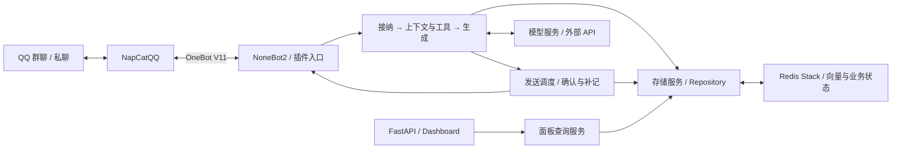

<p align="center">
  
</p>

<h1 align="center">Mako-Bot</h1>

<p align="center">
  ✨&nbsp;<strong>让 QQ 中的角色对话，拥有延续下去的记忆。</strong>&nbsp;✨
</p>

<p align="center">
  <a href="LICENSE"></a>
  <a href="https://github.com/lanxinmob/mako-bot/actions/workflows/ci.yml"></a>
  <a href="pyproject.toml"></a>
</p>

<p align="center">
  <a href="README_EN.md"></a>
  <a href="README.md"></a>
</p>

<p align="center">
  <a href="#体验入口"></a>
  <a href="#快速开始"></a>
  <a href="#配置资源与费用"></a>
  <a href="#文档"></a>
</p>

## 简介

Mako-Bot 是一个可以自行部署的 QQ 角色伙伴，适合私聊和彼此熟悉的小群。她以《千恋万花》中的常陆茉子为角色，聊天时会参考近期对话、人物档案和保存的记忆，用俏皮、有主见的口吻参与交流。除了聊天，她也支持资料检索和定时提醒，并会根据群聊节奏判断是否接话。

随着互动积累，你可以在配套的 Web 面板中查看她保存的记忆、整理的人物档案，以及自主任务记录。Mako-Bot 通过 [NoneBot2](https://github.com/nonebot/nonebot2)、OneBot V11 与 [NapCatQQ](https://github.com/NapNeko/NapCatQQ) 接入 QQ。

## 体验入口

可以先从下面三件事了解茉子。表中给出了测试输入，具体步骤和检查方法见[首次体验](docs/FIRST_RUN.md)。

| 想体验什么 | 从哪里开始 | 怎样核对 |
| --- | --- | --- |
| 对话有延续 | 私聊说“我喜欢乌龙茶”，再用 `/关系记忆` 查看 | 查看或纠正保存的偏好，等原消息离开近期历史后再聊相关话题 |
| 群聊有回应节奏 | 在测试群观察普通闲聊，再 @ 茉子发起对话 | 连续观察回应与沉默，感受不同话题和多人发言时的频率与时机 |
| 提醒确实执行 | 私聊说“五分钟后提醒我喝水”，或在测试群 @ 茉子 | 用 `/我的提醒` 核对时间和内容，再确认到时实际收到消息 |

## 为什么使用 Mako-Bot

- **让互动积累下来**：除了近期对话，也保存用户偏好、关系事件和人物档案，供后续回复参考。
- **给群聊留出空间**：对明确呼叫和普通闲聊采用不同的回应规则，结合当前聊天节奏选择是否接话。
- **记忆能查看，也能纠正**：你可以在私聊中[查看来源、纠正或遗忘自己的关系记忆](docs/COMMANDS.md#人物档案与个人关系记忆)。部署者还可以通过面板了解运行状态，用提醒查询命令核对执行情况。

## 核心能力

| 能力 | 实际用途 |
| --- | --- |
| 角色对话 | 以茉子的身份聊天，参考近期对话，并根据群聊规则和节奏决定是否回应 |
| 记忆与人物档案 | 保存偏好与关系事件，每日从过往记录整理人物信息和重要事件，供后续对话使用 |
| 工具与检索 | 查询天气、网页和资讯，保存笔记，在私聊或群聊设置提醒。工具权限和调用限制可按会话配置 |
| 图片理解 | 配置支持的视觉服务后，可以在聊天中讨论图片内容，每条消息最多处理 3 张 |
| 发送状态 | 区分生成、发送确认与历史补记，帮助部署者排查未送达和待核对结果 |
| Web 面板 | 输入 token 后查看记忆、人物档案、自主任务和运行摘要 |

还可以试试日常小工具：发送 `小鸟 麻雀` 查看鸟种和带授权说明的图片，发送 `传送 唐朝` 阅读历史背景与原创生活小故事，或用 `期刊 Nature` 查询真实刊物。这三个命令不调用付费模型，其他聊天和记忆整理流程仍可能产生模型费用。完整命令和使用要求见[使用说明](docs/COMMANDS.md)。

## 快速开始

> **数据记录说明：** 默认会记录允许接入的群聊消息，包括未 @ 机器人的发言，用于后续记忆整理。设置 `RECORD_UNDIRECTED_GROUP_MESSAGES=false` 可关闭被动记录。启用前请先阅读[记录、模型发送与记忆范围](docs/CONFIGURATION.md#记忆与数据记录)，并告知参与者。

### 1. 获取并安装项目

```bash
git clone https://github.com/lanxinmob/mako-bot.git
cd mako-bot

conda create -n mako-bot python=3.13 pip
conda activate mako-bot
python -m pip install .
```

### 2. 启动 Redis Stack

向量记忆需要 RediSearch，这里使用与部署文件一致的 Redis Stack 版本：

```bash
docker run -d --name mako-redis -p 127.0.0.1:6379:6379 -v mako-redis-data:/data redis/redis-stack-server:7.4.0-v3 redis-stack-server --appendonly yes
```

### 3. 配置模型与连接

首次配置时，运行下面的命令从公开模板创建 `.env`，然后编辑它。如果文件已经存在，命令会报 `FileExistsError`，原文件会保留。这时直接修改已有配置即可。

```bash
python -c "from pathlib import Path; template = Path('.env.example').read_bytes(); target = Path('.env').open('xb'); target.write(template); target.close()"
```

模板中的 `GROUP_ID` 和 `AUTONOMY_OWNER_ID` 是可选整数。暂不使用时，请注释或删除对应行，不要留空。接下来确认以下配置，将模型地址和名称改成你实际使用的服务：

```dotenv
HOST=127.0.0.1
PORT=8080
ONEBOT_ACCESS_TOKEN=replace-with-your-onebot-token
REDIS_URL=redis://127.0.0.1:6379/0

DEEPSEEK_API_KEY=replace-with-your-api-key
DEEPSEEK_BASE_URL=https://your-provider.example/v1
DEEPSEEK_MODEL=your-model-name

PLUGIN_ENABLE_LIST=chat,health,discoveries,dashboard,scheduler,precipitate_knowledge
RECORD_UNDIRECTED_GROUP_MESSAGES=false
```

请替换示例值。本例先关闭被动群消息记录，但进入聊天流程的消息仍可能保存。了解记录范围后，再决定是否开启被动记录。上面的插件清单启用了聊天、健康检查、小功能、Dashboard、资讯命令和每日记忆整理，也避开了当前默认清单里对已删除模块的引用，详见[插件配置](docs/CONFIGURATION.md#插件与工具)。各模型配置能用于哪些功能，见[模型接入说明](docs/CONFIGURATION.md#模型接入范围)。

### 4. 启动并连接 QQ

在项目根目录运行：

```bash
mako-bot
```

启动 NapCat 并登录 QQ，在它的 OneBot V11 连接配置中启用**反向 WebSocket**：

- 地址：`ws://127.0.0.1:8080/onebot/v11/ws`
- token：与 `ONEBOT_ACCESS_TOKEN` 相同

上述地址适用于 NapCat 和机器人直接运行在同一主机的情况。如果 NapCat 在容器或其他主机上，请按[连接拓扑](docs/DEPLOYMENT.md#连接-napcat)填写它能访问的地址。

### 5. 完成第一次验证

在另一个终端检查就绪状态：

```bash
python -c "import urllib.request; print(urllib.request.urlopen('http://127.0.0.1:8080/readyz', timeout=5).read().decode())"
```

正常情况下返回：

```json
{"status":"ready","checks":{"redis":"ok","llm":"configured"}}
```

这表示 Redis 可访问，模型凭据也已配置。接下来，向机器人私聊发送 `/help` 检查命令收发，再发一句普通问候，确认模型能否正常回复。群聊中可以 @ 机器人发起对话。如果没有回复，请按[排查顺序](docs/DEPLOYMENT.md#启动与连接排查)检查。能正常回复后，可以按[首次体验](docs/FIRST_RUN.md)试着保存一条偏好、观察一段群聊，并确认一项提醒实际送达。

如果想查看 Web 面板，设置至少 32 个字符的 `DASHBOARD_TOKEN`，再打开 `http://127.0.0.1:8080/mako/dashboard`，输入相同的 token 即可查看数据。

## 配置、资源与费用

| 你需要决定什么 | 当前情况与入口 |
| --- | --- |
| 使用哪种模型 | 主聊天优先使用 `DEEPSEEK_*`，未配置 key 时使用 OpenAI 备用入口。每日整理和提醒解析使用 `DEEPSEEK_*`。图片输入另有要求，见[接入范围](docs/CONFIGURATION.md#模型接入范围) |
| 记录哪些消息 | 应用默认启用被动群消息记录，本页示例先关闭。不同记忆类型的共享和删除范围见[数据说明](docs/CONFIGURATION.md#记忆与数据记录) |
| 准备多少资源 | 首次使用向量功能可能下载嵌入模型。目前没有统一最低配置或峰值内存实测，可以参考[部署说明](docs/DEPLOYMENT.md#docker-compose)中的环境信息 |
| 如何估算费用 | 对话、提醒解析、图片处理和每日整理都可能调用模型，整理量还受记录消息数影响。应用预算不等于供应商账单，见[预算配置](docs/CONFIGURATION.md#回复预算与自主行动) |

目前还没有逐模型的完整兼容性报告，也没有按消息量统计的费用基准。接入服务后，请实际测试你需要的功能。

## 设计概览

Mako-Bot 是一个 Python 异步单体应用。收到 QQ 消息后，先判断是否处理，再选择上下文、记忆和工具，生成回复后交给发送调度器。Web 面板通过查询服务读取存储。NapCat、Redis Stack 和模型服务独立运行。



- **记忆分层**：近期历史用于衔接对话，关系记忆和人物档案保存用户信息，向量检索补充相关事件。各层的使用范围见配置文档。
- **回应经过多次判断**：从接收消息、调用工具到发送回复，都会检查相应规则，减少过时或不符合权限的回复。自主行动和主动跟进默认关闭。
- **生成与送达分开记录**：模型生成了回复，不代表消息已经发出。主消息、附件和历史补记各自保存状态，无法确认的结果会留下记录，便于核对。

模块职责、详细数据流与恢复边界见[架构说明](docs/ARCHITECTURE.md)。

## 文档

| 文档 | 内容 |
| --- | --- |
| [首次体验](docs/FIRST_RUN.md) | 关系记忆、群聊节奏与提醒的测试输入和核对方式 |
| [部署与排障](docs/DEPLOYMENT.md) | 本机与 Docker Compose 部署、NapCat 连接、探针和持久化 |
| [配置](docs/CONFIGURATION.md) | 模型、插件、记忆记录、权限、预算和 Dashboard |
| [命令与使用](docs/COMMANDS.md) | 小功能、提醒、记忆查询及所需插件 |
| [架构](docs/ARCHITECTURE.md) | 模块职责、数据流、存储和发送状态 |
| [更新记录](docs/CHANGELOG.md) | 已记录的功能变化 |

## 开发与贡献

欢迎通过 [Issues](https://github.com/lanxinmob/mako-bot/issues) 反馈问题或提出建议，也欢迎提交 Pull Request 改进代码与文档。

## LICENSE

[MIT](LICENSE)

## 鸣谢

- [nonebot_plugin-apscheduler](https://github.com/nonebot/plugin-apscheduler)
- [nonebot_plugin_lagrange](https://github.com/Lonely-Sails/nonebot-plugin-lagrange)
- [NapCatQQ](https://github.com/NapNeko/NapCatQQ)
