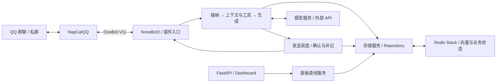

<p align="center">
  
</p>

<h1 align="center">Mako-Bot</h1>

<p align="center">
  ✨&nbsp;<strong>让 QQ 中的角色对话，拥有延续下去的记忆。</strong>&nbsp;✨
</p>

<p align="center">
  <a href="LICENSE"></a>
  <a href="https://github.com/lanxinmob/mako-bot/actions/workflows/ci.yml"></a>
  <a href="pyproject.toml"></a>
</p>

<p align="center">
  <a href="README.md">中文</a> · <a href="README_EN.md">English</a>
  <br>
  <a href="#体验入口">体验入口</a> ·
  <a href="#快速开始">快速开始</a> ·
  <a href="#配置资源与费用">配置与隐私</a> ·
  <a href="#文档">开发文档</a>
</p>

## 简介

Mako-Bot 是一个可自行部署的 QQ 角色伙伴，面向私聊和熟悉的小群。
围绕《千恋万花》中常陆茉子的角色设定，她会参考近期聊天、人物档案与保存的记忆，
以俏皮、有主见的口吻参与对话，并支持群聊回应节奏、资料检索与定时提醒。

部署者可以通过 Web 面板查看保存的记忆、人物档案与自主任务记录。
基于 [NoneBot2](https://github.com/nonebot/nonebot2)、OneBot V11 与
[NapCatQQ](https://github.com/NapNeko/NapCatQQ)。

## 体验入口

先从这三件事了解茉子。下面是测试输入示例，具体步骤与核对方法见[首次体验](docs/FIRST_RUN.md)。

| 想体验什么 | 从哪里开始 | 怎样核对 |
| --- | --- | --- |
| 对话有延续 | 私聊说“我喜欢乌龙茶”，再用 `/关系记忆` 查看 | 核对保存的偏好，也可以纠正；超出近期历史后再聊相关话题 |
| 群聊有回应节奏 | 在测试群观察普通闲聊，再 @ 茉子发起对话 | 连续观察回应与沉默，感受不同话题和多人发言时的频率与时机 |
| 提醒确实执行 | 私聊说“五分钟后提醒我喝水”，或在测试群 @ 茉子 | 用 `/我的提醒` 核对时间和内容，再确认到时实际收到消息 |

## 为什么使用 Mako-Bot

- **让互动积累下来**：除了近期对话，也保存用户偏好、关系事件和人物档案，供后续回复参考。
- **给群聊留出空间**：明确呼叫和普通闲聊分别判断，结合会话节奏选择是否回应。
- **让保存与执行看得见**：自己可在私聊解释、纠正和遗忘关系记忆；部署者可在面板查看来源与运行状态，提醒另有查询命令。

私聊可用 `解释记忆 ID`、`纠正记忆 ID 现在不喜欢乌龙茶了`、`忘掉记忆 ID`。
更正生成新 ID；遗忘清空同主题账本和镜像，停止相关跟进。首次更正或遗忘后，
旧整段画像与无来源向量暂停用于相关回复；历史聊天和备份仍保留。
只有 `重新记住 ID 我喜欢乌龙茶` 可以明确恢复已遗忘主题，普通重述不会自动恢复。

启用 `companion` 插件后，可在本人私聊创建一个考试计划，填写 1–3 个任务和准确的北京时间。
计划最多发送一次考前提醒和一次本人明确同意的考后回顾邀请；不回复时保持安静。
用 `我的考试计划` 核对状态，`取消计划 ID` 停止后续动作，`忘掉计划 ID` 清除关联正文。
完整格式与授权边界见[考试陪伴命令](docs/COMMANDS.md#考试陪伴)。

适合愿意维护 QQ 接入、存储与模型配置的个人部署者，以及希望研究角色对话与记忆流程的开发者。
当前角色由[代码中的提示词](src/core/prompts.py)定义；更换角色需要修改提示词，尚无现成的多角色切换配置。

## 核心能力

| 能力 | 实际用途 |
| --- | --- |
| 角色对话 | 以茉子的角色身份持续聊天，并参考近期对话；群聊根据规则和节奏决定是否回应 |
| 记忆与人物档案 | 保存偏好与关系事件，每日从过往记录整理人物信息和重要事件，供后续对话使用 |
| 工具与检索 | 查询天气、网页和资讯，保存笔记，在私聊或群聊设置提醒；可按会话配置工具权限和调用限制 |
| 图片理解 | 配置支持的视觉服务后，在聊天中讨论图片内容；每条消息最多处理 3 张 |
| 发送状态 | 区分生成、发送确认与历史补记，帮助部署者排查未送达和待核对结果 |
| Web 面板 | 通过受 token 保护的数据接口查看记忆、人物档案、自主任务及运行摘要 |

还有一些日常小工具：`小鸟 麻雀` 查看鸟种与带授权说明的图片，`传送 唐朝` 阅读历史背景与原创生活小故事，
`期刊 Nature` 查询真实刊物。这三个明确命令路径不调用付费模型，其他聊天与整理流程仍可能产生模型费用。
完整命令与要求见[使用说明](docs/COMMANDS.md)。

## 快速开始

> **数据记录说明：** 默认记录允许群聊中的消息，包括未 @ 机器人的发言，用于后续记忆整理。
> 设置 `RECORD_UNDIRECTED_GROUP_MESSAGES=false` 可关闭被动记录。
> 启用前请了解[记录、模型发送与记忆范围](docs/CONFIGURATION.md#记忆与数据记录)，并告知参与者。

本页使用 **本机 Python + Docker Redis Stack + 独立 NapCat**，适合能分别维护这三个组件的部署者。
需要 Python、Docker、可用的模型服务，以及能下载嵌入模型和访问资料来源的网络。
容器部署与跨主机连接见[部署文档](docs/DEPLOYMENT.md)。

### 1. 获取并安装项目

```bash
git clone https://github.com/lanxinmob/mako-bot.git
cd mako-bot
python -m venv .venv
```

激活虚拟环境：

| 平台 | 命令 |
| --- | --- |
| Windows PowerShell | `.venv\Scripts\Activate.ps1` |
| Linux / macOS | `source .venv/bin/activate` |

```bash
python -m pip install .
```

### 2. 启动Redis Stack

向量记忆依赖RediSearch，因此使用与部署文件一致的Redis Stack版本：

```bash
docker run -d --name mako-redis -p 127.0.0.1:6379:6379 -v mako-redis-data:/data redis/redis-stack-server:7.4.0-v3 redis-stack-server --appendonly yes
```

### 3. 配置模型与连接

首次配置时复制公开模板，随后编辑新建的 `.env`。下列命令使用独占创建，
已有 `.env` 时会报 `FileExistsError` 并保留原文件，此时直接编辑原配置：

```bash
python -c "from pathlib import Path; template = Path('.env.example').read_bytes(); target = Path('.env').open('xb'); target.write(template); target.close()"
```

模板中的 `GROUP_ID` 与 `AUTONOMY_OWNER_ID` 是可选整数；暂不使用时注释或删除对应行，不能留空。
以下字段是本路径需要确认的内容，模型地址和名称应填写你实际使用的服务配置：

```dotenv
HOST=127.0.0.1
PORT=8080
ONEBOT_ACCESS_TOKEN=replace-with-your-onebot-token
REDIS_URL=redis://127.0.0.1:6379/0

DEEPSEEK_API_KEY=replace-with-your-api-key
DEEPSEEK_BASE_URL=https://your-provider.example/v1
DEEPSEEK_MODEL=your-model-name

PLUGIN_ENABLE_LIST=chat,health,discoveries,dashboard,scheduler,precipitate_knowledge
RECORD_UNDIRECTED_GROUP_MESSAGES=false
```

示例值需要替换。这里先关闭被动群消息记录，聊天流程接纳的消息仍可保存；了解记录范围后再决定是否开启。
显式插件清单启用聊天、健康检查、小功能、Dashboard、资讯命令与每日记忆整理，
并避开当前默认清单中已删除模块的引用，详见[插件配置](docs/CONFIGURATION.md#插件与工具)。
模型入口的能力范围见[模型接入说明](docs/CONFIGURATION.md#模型接入范围)。

### 4. 启动并连接QQ

在项目根目录运行：

```bash
mako-bot
```

启动NapCat并登录QQ，在其OneBot V11连接配置中启用**反向WebSocket**：

- 地址：`ws://127.0.0.1:8080/onebot/v11/ws`
- token：与 `ONEBOT_ACCESS_TOKEN` 相同

上述地址适用于NapCat与机器人在同一主机直接运行的情况。
NapCat在容器或其他主机时，按[连接拓扑](docs/DEPLOYMENT.md#连接napcat)配置可达地址。

### 5. 完成第一次验证

在另一个终端检查就绪状态：

```bash
python -c "import urllib.request; print(urllib.request.urlopen('http://127.0.0.1:8080/readyz', timeout=5).read().decode())"
```

正常情况下返回：

```json
{"status":"ready","checks":{"redis":"ok","llm":"configured"}}
```

这表示Redis可访问、模型凭据已配置；它不验证模型请求和QQ连接。
再向机器人私聊发送 `/help` 检查命令收发，发送一句普通问候检查模型对话。
群聊可使用@机器人明确发起对话。失败时按[排查顺序](docs/DEPLOYMENT.md#启动与连接排查)检查。

能回复以后，按[首次体验](docs/FIRST_RUN.md)核对一条保存的偏好、一次群聊回应过程和一项实际送达的提醒。

可选：设置至少32字符的 `DASHBOARD_TOKEN`，打开
`http://127.0.0.1:8080/mako/dashboard`，在页面中输入token查看数据。

## 配置、资源与费用

| 你需要决定什么 | 当前情况与入口 |
| --- | --- |
| 使用哪种模型 | 主聊天优先使用 `DEEPSEEK_*` 配置，也有 OpenAI 备用入口；每日整理和提醒解析使用 `DEEPSEEK_*`。图片输入另有要求，见[接入范围](docs/CONFIGURATION.md#模型接入范围) |
| 记录哪些消息 | 应用默认启用被动群消息记录，本页示例先关闭；不同记忆类型的共享与删除范围见[数据说明](docs/CONFIGURATION.md#记忆与数据记录) |
| 准备多少资源 | 首次使用向量功能可能下载嵌入模型。尚无统一最低配置或峰值内存实测；作者当前服务器的总资源上限为 4GB 内存 / 2 CPU，供部署环境参考，见[部署说明](docs/DEPLOYMENT.md#docker-compose) |
| 如何估算费用 | 对话、提醒解析、图片处理与每日整理都可能调用模型；整理量还受记录消息数影响。应用预算不等于供应商账单，见[预算配置](docs/CONFIGURATION.md#回复预算与自主行动) |

仓库尚无逐模型的端到端兼容性报告及按消息量统计的费用基准，选用兼容接口后仍需验证实际能力。

## 设计概览

Mako-Bot 采用 Python 异步单体应用。一条 QQ 消息先经过接纳判断，再选择上下文、记忆与工具，
生成回复后交给发送调度器。Web 面板通过查询服务读取存储；NapCat、Redis Stack 与模型服务在进程外运行。



- **记忆分层**：近期历史保留对话连续性，关系记忆与人物档案保存用户信息，向量检索补充相关事件；各层的范围见配置文档。
- **回应经过多次判断**：接纳、工具权限与发送前检查分别执行，减少无效候选进入实际群聊；自主行动与主动跟进默认关闭。
- **生成与送达分开记录**：模型已生成不代表消息已发出，主消息、附件与历史补记各自保存状态；未知结果保留核对。

模块职责、详细数据流与恢复边界见[架构说明](docs/ARCHITECTURE.md)。

## 文档

| 文档 | 内容 |
| --- | --- |
| [首次体验](docs/FIRST_RUN.md) | 关系记忆、群聊节奏与提醒的测试输入和核对方式 |
| [部署与排障](docs/DEPLOYMENT.md) | 本机与Docker Compose部署、NapCat连接、探针和持久化 |
| [配置](docs/CONFIGURATION.md) | 模型、插件、记忆记录、权限、预算和Dashboard |
| [命令与使用](docs/COMMANDS.md) | 小功能、提醒、记忆查询及所需插件 |
| [架构](docs/ARCHITECTURE.md) | 模块职责、数据流、存储和发送状态 |
| [更新记录](docs/CHANGELOG.md) | 已记录的功能变化 |

## 开发与贡献

欢迎通过 [Issues](https://github.com/lanxinmob/mako-bot/issues) 反馈问题或提出建议，也欢迎提交 Pull Request 改进代码与文档。

## LICENSE

本项目源码采用 [MIT License](LICENSE)。

## 鸣谢

- [nonebot_plugin-apscheduler](https://github.com/nonebot/plugin-apscheduler)
- [nonebot_plugin_lagrange](https://github.com/Lonely-Sails/nonebot-plugin-lagrange)
- [NapCatQQ](https://github.com/NapNeko/NapCatQQ)
