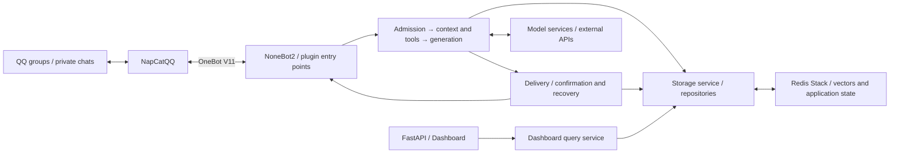

<p align="center">
  
</p>

<h1 align="center">Mako-Bot</h1>

<p align="center">
  ✨ <strong>Give character conversations on QQ memories that carry forward.</strong> ✨
</p>

<p align="center">
  <a href="README.md">中文</a> · <a href="README_EN.md">English</a>
</p>

Mako-Bot is a self-hosted character companion for QQ private chats and small groups of people who know each other.
Built around Hitachi Mako from *Senren＊Banka*, she draws on recent conversations, user profiles and saved memories
to participate with a playful, opinionated voice. The application also supports group reply pacing, information retrieval and scheduled reminders.

Operators can use the Web dashboard to inspect saved memories, user profiles and autonomous task records.
Built with [NoneBot2](https://github.com/nonebot/nonebot2), OneBot V11 and
[NapCatQQ](https://github.com/NapNeko/NapCatQQ).

<p align="center">
  <a href="LICENSE"></a>
  <a href="https://github.com/lanxinmob/mako-bot/actions/workflows/ci.yml"></a>
  <a href="pyproject.toml"></a>
</p>

<p align="center">
  <a href="#try-mako">Try Mako</a> ·
  <a href="#quick-start">Quick start</a> ·
  <a href="#configuration-resources-and-costs">Configuration and privacy</a> ·
  <a href="#documentation">Documentation</a>
</p>

## Try Mako

Start with these three experiences. The messages below are test inputs; see the [first-run guide](docs/FIRST_RUN.md) for steps and checks.
QQ commands retain their Chinese names in this English README.

| Experience | Where to start | What to check |
| --- | --- | --- |
| Conversation continuity | Say “我喜欢乌龙茶” (“I like oolong tea”) in private chat, then send `/关系记忆` | Check the saved preference and try correcting it; return to the topic after the original message leaves recent history |
| Group reply pacing | Observe ordinary conversation in a test group, then @ Mako | Watch replies and silence across different topics and conversations with several participants |
| A reminder that runs | Say “五分钟后提醒我喝水” (“Remind me to drink water in five minutes”) in private chat, or @ Mako in a test group | Use `/我的提醒` to check the time and content, then confirm that the reminder actually arrives |

## Why use Mako-Bot

- **Let interactions accumulate**: user preferences, relationship events and profiles are saved alongside recent history for later replies to reference.
- **Leave room for group conversation**: direct requests and ordinary conversation are assessed separately, with session pacing used to decide whether to reply.
- **Inspect saved information and execution**: users can explain, correct and forget relationship memories in private chat. Operators can inspect sources and runtime status in the dashboard; reminders have separate query commands.

In private chat, use `解释记忆 ID`, `纠正记忆 ID 现在不喜欢乌龙茶了` or `忘掉记忆 ID`.
A correction creates a new ID. Forgetting clears the ledger and mirrored records for the same topic and stops related follow-ups.
After the first correction or forgetting action, the old full profile and vectors without provenance are suspended from related replies;
chat history and backups remain. Only `重新记住 ID 我喜欢乌龙茶` explicitly restores a forgotten topic.
Repeating the preference in ordinary conversation does not restore it automatically.

With the `companion` plugin enabled, users can create an exam plan in their own private chat with 1–3 tasks and an exact time in Beijing time.
A plan sends at most one reminder before the exam and one invitation to reflect afterward, with the user's explicit consent for the latter.
It remains quiet if the user does not reply. Use `我的考试计划` to inspect its status, `取消计划 ID` to stop future actions,
or `忘掉计划 ID` to clear associated text. See [exam companion commands](docs/COMMANDS.md#考试陪伴) for formats and authorization boundaries.

Mako-Bot is intended for individuals willing to maintain QQ connectivity, storage and model configuration,
and developers studying character conversations and memory workflows.
The current character is defined in [the prompt source](src/core/prompts.py). Changing characters requires editing the prompt;
there is no ready-made multi-character switching setting.

## Capabilities

| Capability | Practical use |
| --- | --- |
| Character conversations | Chat as Mako with recent conversation context; group rules and pacing determine whether to reply |
| Memories and profiles | Save preferences and relationship events, then consolidate user information and significant events from past records each day |
| Tools and retrieval | Query weather, web pages and news, save notes and set private or group reminders; configure tool permissions and invocation limits by session type |
| Image understanding | Discuss images after configuring a supported vision service; process at most 3 images per message |
| Delivery status | Separate generation, send confirmation and history recovery to help operators investigate undelivered or unresolved results |
| Web dashboard | Inspect memories, profiles, autonomous tasks and runtime summaries through token-protected data endpoints |

There are also a few everyday tools: `小鸟 麻雀` looks up a bird species and images with licensing information,
`传送 唐朝` provides historical context and an original fictional slice-of-life story, and `期刊 Nature` looks up a real journal.
These three explicit command paths do not call paid models; other chat and consolidation workflows may incur model costs.
See [commands and usage](docs/COMMANDS.md) for the full list and requirements.

## Quick start

> **Data recording:** by default, messages in allowed groups are recorded for later memory consolidation, including messages that do not @ the bot.
> Set `RECORD_UNDIRECTED_GROUP_MESSAGES=false` to disable passive recording.
> Before enabling it, read about [recording, model requests and memory scope](docs/CONFIGURATION.md#记忆与数据记录), and inform participants.

This guide uses **local Python + Redis Stack in Docker + a separate NapCat instance**, for operators able to maintain all three components.
You need Python, Docker, an available model service and network access to download the embedding model and reach information sources.
See the [deployment guide](docs/DEPLOYMENT.md) for container deployments and connections across hosts.

### 1. Get and install the project

```bash
git clone https://github.com/lanxinmob/mako-bot.git
cd mako-bot
python -m venv .venv
```

Activate the virtual environment:

| Platform | Command |
| --- | --- |
| Windows PowerShell | `.venv\Scripts\Activate.ps1` |
| Linux / macOS | `source .venv/bin/activate` |

```bash
python -m pip install .
```

### 2. Start Redis Stack

Vector memory requires RediSearch. Use the same Redis Stack version as the deployment configuration:

```bash
docker run -d --name mako-redis -p 127.0.0.1:6379:6379 -v mako-redis-data:/data redis/redis-stack-server:7.4.0-v3 redis-stack-server --appendonly yes
```

### 3. Configure the model and connections

For first-time setup, copy the public template and edit the new `.env`.
The following command creates the file exclusively: if `.env` already exists, it raises `FileExistsError` and preserves the existing file.
In that case, edit your current configuration directly.

```bash
python -c "from pathlib import Path; template = Path('.env.example').read_bytes(); target = Path('.env').open('xb'); target.write(template); target.close()"
```

`GROUP_ID` and `AUTONOMY_OWNER_ID` in the template are optional integers. Comment out or remove unused entries; do not leave them empty.
Check the following fields for this setup, using the address and model name of your actual service:

```dotenv
HOST=127.0.0.1
PORT=8080
ONEBOT_ACCESS_TOKEN=replace-with-your-onebot-token
REDIS_URL=redis://127.0.0.1:6379/0

DEEPSEEK_API_KEY=replace-with-your-api-key
DEEPSEEK_BASE_URL=https://your-provider.example/v1
DEEPSEEK_MODEL=your-model-name

PLUGIN_ENABLE_LIST=chat,health,discoveries,dashboard,scheduler,precipitate_knowledge
RECORD_UNDIRECTED_GROUP_MESSAGES=false
```

Replace the example values. This example starts with passive group recording disabled; messages admitted by the chat workflow may still be saved.
Decide whether to enable passive recording after reviewing its scope.
The explicit plugin list enables chat, health checks, everyday tools, the dashboard, news commands and daily memory consolidation.
It also avoids a deleted module still referenced by the current default list; see [plugin configuration](docs/CONFIGURATION.md#插件与工具).
See [model integration scope](docs/CONFIGURATION.md#模型接入范围) for the capabilities of each model entry point.

### 4. Start the bot and connect QQ

Run from the project root:

```bash
mako-bot
```

Start NapCat and log in to QQ. Enable a **reverse WebSocket** in its OneBot V11 connection settings:

- URL: `ws://127.0.0.1:8080/onebot/v11/ws`
- Token: the same value as `ONEBOT_ACCESS_TOKEN`

This address applies when NapCat and the bot run directly on the same host.
For NapCat in a container or on another host, use a reachable address according to the [connection topology](docs/DEPLOYMENT.md#连接napcat).

### 5. Verify the first conversation

Check readiness from another terminal:

```bash
python -c "import urllib.request; print(urllib.request.urlopen('http://127.0.0.1:8080/readyz', timeout=5).read().decode())"
```

A ready response is:

```json
{"status":"ready","checks":{"redis":"ok","llm":"configured"}}
```

This means Redis is reachable and model credentials are configured. It does not validate a model request or the QQ connection.
Send `/help` in private chat to check command delivery, then send an ordinary greeting to check model conversation.
In a group, @ the bot to address it explicitly. Follow the [troubleshooting sequence](docs/DEPLOYMENT.md#启动与连接排查) if a step fails.

Once it replies, follow the [first-run guide](docs/FIRST_RUN.md) to check a saved preference, a group reply sequence and a delivered reminder.

Optionally, set `DASHBOARD_TOKEN` to a value of at least 32 characters, open
`http://127.0.0.1:8080/mako/dashboard` and enter the token to inspect the data.

## Configuration, resources and costs

| Decision | Current behavior and documentation |
| --- | --- |
| Which model to use | Main chat uses `DEEPSEEK_*` when its key is configured, otherwise `OPENAI_*`; daily consolidation and reminder parsing use `DEEPSEEK_*`. Images have additional requirements; see [integration scope](docs/CONFIGURATION.md#模型接入范围) |
| Which messages to record | Passive group recording is enabled by default and disabled in this example. See [data behavior](docs/CONFIGURATION.md#记忆与数据记录) for sharing and deletion across memory types |
| How much capacity to provide | The first vector operation may download the embedding model. There are no standardized minimum requirements or peak-memory measurements. The author's current server has a total capacity of 4GB RAM / 2 CPUs, provided as deployment context; see [deployment](docs/DEPLOYMENT.md#docker-compose) |
| How to estimate costs | Conversations, reminder parsing, image processing and daily consolidation can call models; consolidation also depends on the number of recorded messages. Application budgets are not provider bills; see [budget configuration](docs/CONFIGURATION.md#回复预算与自主行动) |

The repository has no per-model end-to-end compatibility report or cost benchmark by message volume.
After selecting a compatible API, verify the capabilities you need.

## Design overview

Mako-Bot is an asynchronous Python monolith. A QQ message passes admission checks, then context, memories and tools are selected.
Generated replies go to the delivery dispatcher. The dashboard reads storage through a query service;
NapCat, Redis Stack and model services run outside the application process.



- **Layered memory**: recent history provides continuity, relationship memories and profiles store user information, and vector retrieval adds relevant events. The configuration guide describes each layer's scope.
- **Multiple reply checks**: admission, tool permissions and checks before sending are separate, reducing invalid candidates reaching a group. Autonomous actions and proactive follow-ups are disabled by default.
- **Generation and delivery are recorded separately**: a generated response is not necessarily sent. Main messages, attachments and history updates have separate states; unresolved results remain available for review.

See [architecture](docs/ARCHITECTURE.md) for module responsibilities, detailed flows and recovery boundaries.

## Documentation

The detailed guides below are currently in Chinese.

| Guide | Contents |
| --- | --- |
| [First-run experience](docs/FIRST_RUN.md) | Test inputs and checks for relationship memories, group pacing and reminders |
| [Deployment and troubleshooting](docs/DEPLOYMENT.md) | Local and Docker Compose setups, NapCat connections, probes and persistence |
| [Configuration](docs/CONFIGURATION.md) | Models, plugins, recording, permissions, budgets and the dashboard |
| [Commands and usage](docs/COMMANDS.md) | Everyday tools, reminders, memory queries and required plugins |
| [Architecture](docs/ARCHITECTURE.md) | Responsibilities, data flow, storage and delivery state |
| [Changelog](docs/CHANGELOG.md) | Recorded feature changes |

## Development and contributions

Use [Issues](https://github.com/lanxinmob/mako-bot/issues) to report problems or suggest improvements.
Pull Requests improving the code or documentation are welcome.

## LICENSE

The source code is licensed under the [MIT License](LICENSE).

## Acknowledgements

- [nonebot_plugin-apscheduler](https://github.com/nonebot/plugin-apscheduler)
- [nonebot_plugin_lagrange](https://github.com/Lonely-Sails/nonebot-plugin-lagrange)
- [NapCatQQ](https://github.com/NapNeko/NapCatQQ)
