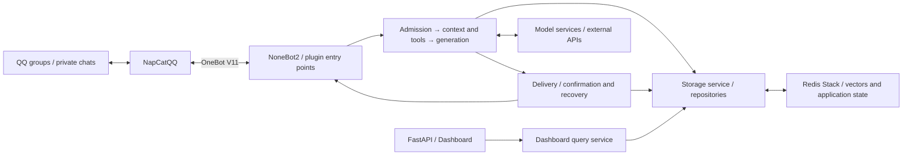

<p align="center">
  
</p>

<h1 align="center">Mako-Bot</h1>

<p align="center">
  ✨&nbsp;<strong>Give character conversations on QQ memories that carry forward.</strong>&nbsp;✨
</p>

<p align="center">
  <a href="LICENSE"></a>
  <a href="https://github.com/lanxinmob/mako-bot/actions/workflows/ci.yml"></a>
  <a href="pyproject.toml"></a>
</p>

<p align="center">
  <a href="README_EN.md"></a>
  <a href="README.md"></a>
</p>

<p align="center">
  <a href="#try-mako"></a>
  <a href="#quick-start"></a>
  <a href="#configuration-resources-and-costs"></a>
  <a href="#documentation"></a>
</p>

## Overview

Mako-Bot is a self-hosted character companion for QQ private chats and small groups of people who know each other. She takes on the role of Hitachi Mako from *Senren＊Banka*, drawing on recent conversations, user profiles and saved memories to chat in a playful, opinionated voice. She can also look up information, set reminders and decide when to join a group conversation.

The companion comes with a Web dashboard where you can review the memories and profiles she builds over time, along with autonomous task records. Mako-Bot connects to QQ through [NoneBot2](https://github.com/nonebot/nonebot2), OneBot V11 and [NapCatQQ](https://github.com/NapNeko/NapCatQQ).

## Try Mako

Try these three things to get to know Mako. The table gives example test messages. Follow the [first-run guide](docs/en/FIRST_RUN.md) for steps and checks.

| Experience | Where to start | What to check |
| --- | --- | --- |
| Conversation continuity | Say “I like oolong tea” in private chat, then send `/memories` | View or correct the saved preference, then return to the topic after the original message leaves recent history |
| Group reply pacing | Observe ordinary conversation in a test group, then @ Mako | Watch replies and silence across different topics and conversations with several participants |
| A reminder that runs | Say “Remind me to drink water in five minutes” in private chat, or @ Mako in a test group | Use `/reminders` to check the time and content, then confirm that the reminder actually arrives |

English command aliases are supported. Replies and historical stories are currently mainly in Chinese. Explicit preferences such as “I like oolong tea” and “I no longer like oolong tea” can be saved and managed with the memory commands. Natural-language reminders use your configured model, so check the parsed time and content with `/reminders`.

## Why use Mako-Bot

- **Let interactions accumulate**: saved preferences, relationship events and profiles give later conversations more context alongside recent history.
- **Leave room for group conversation**: direct requests and ordinary chat follow different reply rules, with the current conversation pace helping determine when to join in.
- **View and correct memories**: in private chat, you can [check sources, correct or forget your own relationship memories](docs/en/COMMANDS.md#profiles-and-personal-relationship-memories). Operators can also check runtime status in the dashboard and use reminder commands to inspect reminders.

## Capabilities

| Capability | Practical use |
| --- | --- |
| Character conversations | Chat as Mako with recent conversation context, using group rules and pacing to decide whether to reply |
| Memories and profiles | Save preferences and relationship events, then consolidate user information and significant events from past records each day |
| Tools and retrieval | Look up weather, web pages and news, save notes and set private or group reminders. Tool permissions and call limits can be configured by session type |
| Image understanding | Discuss images after configuring a supported vision service, with up to 3 images per message |
| Delivery status | Separate generation, send confirmation and history recovery to help operators investigate undelivered or unresolved results |
| Web dashboard | Enter a token to view memories, profiles, autonomous tasks and runtime summaries |

There are also a few everyday tools: `bird Passer montanus` looks up a bird species and images with licensing information, `journey Tang dynasty` provides historical context and an original fictional slice-of-life story, and `journal Nature` looks up a real journal. These three commands do not call paid models. Other chat and memory consolidation workflows may incur model costs. See [commands and usage](docs/en/COMMANDS.md) for the full list and requirements.

## Quick start

> **Data recording:** by default, messages in allowed groups are recorded for later memory consolidation, including messages that do not @ the bot. Set `RECORD_UNDIRECTED_GROUP_MESSAGES=false` to disable passive recording. Before enabling it, read about [recording, model requests and memory scope](docs/en/CONFIGURATION.md#memory-and-data-recording), and inform participants.

### 1. Get and install the project

```bash
git clone https://github.com/lanxinmob/mako-bot.git
cd mako-bot

conda create -n mako-bot python=3.13 pip
conda activate mako-bot
python -m pip install .
```

### 2. Start Redis Stack

Vector memory requires RediSearch. Use the same Redis Stack version as the deployment configuration:

```bash
docker run -d --name mako-redis -p 127.0.0.1:6379:6379 -v mako-redis-data:/data redis/redis-stack-server:7.4.0-v3 redis-stack-server --appendonly yes
```

### 3. Configure the model and connections

For first-time setup, run the command below to create `.env` from the public template, then edit it. If the file already exists, the command raises `FileExistsError` and preserves it. In that case, edit your existing configuration.

```bash
python -c "from pathlib import Path; template = Path('.env.example').read_bytes(); target = Path('.env').open('xb'); target.write(template); target.close()"
```

`GROUP_ID` and `AUTONOMY_OWNER_ID` in the template are optional integers. Comment out or remove unused entries rather than leaving them empty. Check the following fields for this setup, using the address and model name of your actual service:

```dotenv
HOST=127.0.0.1
PORT=8080
ONEBOT_ACCESS_TOKEN=replace-with-your-onebot-token
REDIS_URL=redis://127.0.0.1:6379/0

DEEPSEEK_API_KEY=replace-with-your-api-key
DEEPSEEK_BASE_URL=https://your-provider.example/v1
DEEPSEEK_MODEL=your-model-name

PLUGIN_ENABLE_LIST=chat,health,discoveries,dashboard,scheduler,precipitate_knowledge
RECORD_UNDIRECTED_GROUP_MESSAGES=false
```

Replace the example values. Passive group recording starts disabled in this example, but messages accepted by the chat workflow may still be saved. Read about what is recorded before deciding whether to enable passive recording. The plugin list above enables chat, health checks, everyday tools, the dashboard, news commands and daily memory consolidation. Using this list also avoids a deleted module still referenced by the current defaults. See [plugin configuration](docs/en/CONFIGURATION.md#plugins-and-tools) for details. See [model integration scope](docs/en/CONFIGURATION.md#model-integration-scope) for the capabilities of each model entry point.

### 4. Start the bot and connect QQ

Run from the project root:

```bash
mako-bot
```

Start NapCat and log in to QQ. Enable a **reverse WebSocket** in its OneBot V11 connection settings:

- URL: `ws://127.0.0.1:8080/onebot/v11/ws`
- Token: the same value as `ONEBOT_ACCESS_TOKEN`

This address applies when NapCat and the bot run directly on the same host. For NapCat in a container or on another host, use a reachable address according to the [connection topology](docs/en/DEPLOYMENT.md#connect-napcat).

### 5. Verify the first conversation

Check readiness from another terminal:

```bash
python -c "import urllib.request; print(urllib.request.urlopen('http://127.0.0.1:8080/readyz', timeout=5).read().decode())"
```

A ready response is:

```json
{"status":"ready","checks":{"redis":"ok","llm":"configured"}}
```

This means Redis is reachable and model credentials are configured. It does not validate a model request or the QQ connection. Send `/help` in private chat to check command delivery, then send an ordinary greeting to check model conversation. In a group, @ the bot to address it explicitly. Follow the [troubleshooting sequence](docs/en/DEPLOYMENT.md#startup-and-connection-troubleshooting) if a step fails.

Once it replies, follow the [first-run guide](docs/en/FIRST_RUN.md) to check a saved preference, a group reply sequence and a delivered reminder.

Optionally, set `DASHBOARD_TOKEN` to a value of at least 32 characters, open `http://127.0.0.1:8080/mako/dashboard` and enter the token to inspect the data.

## Configuration, resources and costs

| Decision | Current behavior and documentation |
| --- | --- |
| Which model to use | Main chat uses `DEEPSEEK_*` when its key is configured, otherwise `OPENAI_*`. Daily consolidation and reminder parsing use `DEEPSEEK_*`. Images have additional requirements, described in [integration scope](docs/en/CONFIGURATION.md#model-integration-scope) |
| Which messages to record | Passive group recording is enabled by default and disabled in this example. See [data behavior](docs/en/CONFIGURATION.md#memory-and-data-recording) for sharing and deletion across memory types |
| How much capacity to provide | The first vector operation may download the embedding model. There are no standardized minimum requirements or peak-memory measurements. See [deployment](docs/en/DEPLOYMENT.md#docker-compose) for environment details |
| How to estimate costs | Conversations, reminder parsing, image processing and daily consolidation can call models. Consolidation also depends on the number of recorded messages. Application budgets are separate from provider bills. See [budget configuration](docs/en/CONFIGURATION.md#replies-budgets-and-autonomy) |

There is no complete per-model compatibility report or cost benchmark by message volume yet. After connecting a service, try the features you need on your own deployment.

## Design overview

Mako-Bot is an asynchronous Python monolith. When a QQ message arrives, the application decides whether to handle it, then selects context, memories and tools. Generated replies go to the delivery dispatcher. The dashboard reads storage through a query service. NapCat, Redis Stack and model services run as separate components.



- **Layered memory**: recent history provides continuity, relationship memories and profiles store user information, and vector retrieval adds relevant events. The configuration guide describes each layer's scope.
- **Replies pass several checks**: rules are checked when accepting messages, running tools and sending replies to reduce outdated or unauthorized replies. Autonomous actions and proactive follow-ups are disabled by default.
- **Generation and delivery are recorded separately**: generating a reply does not mean it was sent. Main messages, attachments and history updates have separate states. Unconfirmed results stay on record so they can be checked later.

See [architecture](docs/en/ARCHITECTURE.md) for module responsibilities, detailed flows and recovery boundaries.

## Documentation

The guides below are available in English and Chinese. Use the language link at the top of each guide to switch.

| Guide | Contents |
| --- | --- |
| [First-run experience](docs/en/FIRST_RUN.md) | Test inputs and checks for relationship memories, group pacing and reminders |
| [Deployment and troubleshooting](docs/en/DEPLOYMENT.md) | Local and Docker Compose setups, NapCat connections, probes and persistence |
| [Configuration](docs/en/CONFIGURATION.md) | Models, plugins, recording, permissions, budgets and the dashboard |
| [Commands and usage](docs/en/COMMANDS.md) | Everyday tools, reminders, memory queries and required plugins |
| [Architecture](docs/en/ARCHITECTURE.md) | Responsibilities, data flow, storage and delivery state |
| [Changelog](docs/en/CHANGELOG.md) | Recorded feature changes |

## Development and contributions

Use [Issues](https://github.com/lanxinmob/mako-bot/issues) to report problems or suggest improvements. Pull Requests improving the code or documentation are welcome.

## LICENSE

[MIT](LICENSE)

## Acknowledgements

- [nonebot_plugin-apscheduler](https://github.com/nonebot/plugin-apscheduler)
- [nonebot_plugin_lagrange](https://github.com/Lonely-Sails/nonebot-plugin-lagrange)
- [NapCatQQ](https://github.com/NapNeko/NapCatQQ)
