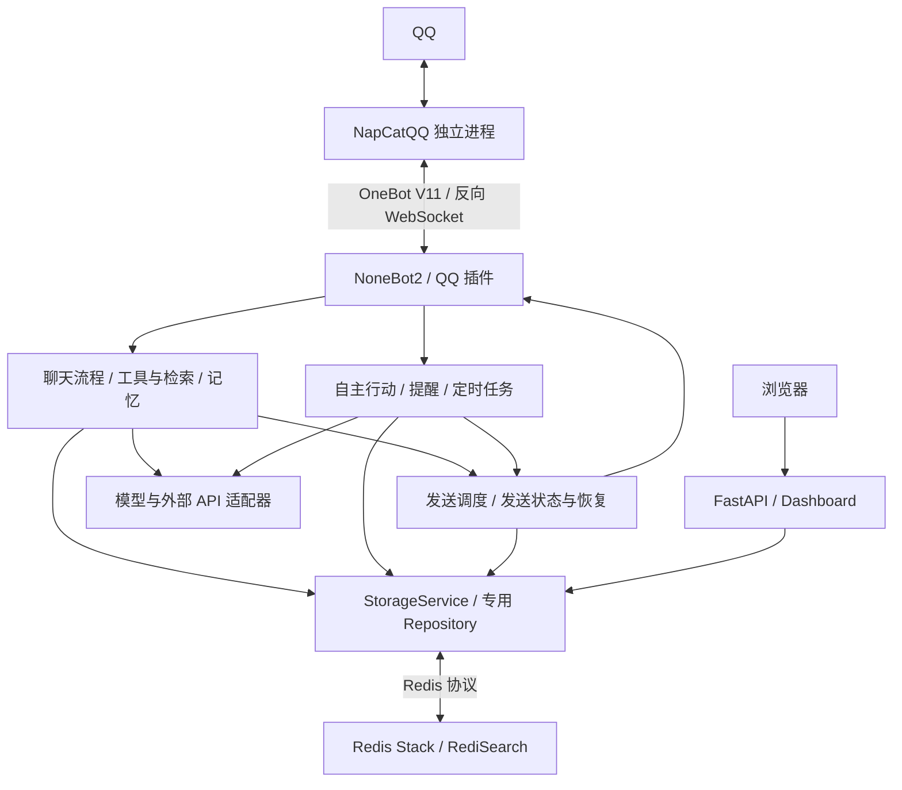

# 架构说明

[返回README](../README.md) · [部署与状态检查](DEPLOYMENT.md)

Mako-Bot 是一个基于 Python 异步运行时的单体应用。NoneBot2 承载 QQ 事件和插件，
其 FastAPI 服务同时提供健康检查与 Dashboard；NapCatQQ、Redis Stack 和模型/API
服务在应用进程之外，通过 OneBot V11、Redis 协议或 HTTP 连接。

### 模块职责

| 路径 | 职责 |
| --- | --- |
| `bot.py`、`src/app.py` | 源码与安装包入口；初始化 NoneBot、注册 OneBot V11 适配器、加载应用插件及关闭清理 |
| `src/core/`、`src/models/`、`src/utils/` | 环境配置、人设提示词、日志与错误类型、数据模型、消息规范化及渲染辅助 |
| `src/plugins/` | QQ matcher、HTTP 路由、定时任务注册及运行时组装；将输入交给服务，并通过发送适配器返回结果 |
| `src/services/chat/` | 接纳与节奏控制、群聊窗口和候选回复、上下文组装、模型生成，以及聊天历史提交与恢复 |
| `src/services/tools/`、`src/services/governance/` | 意图路由、工具开关、群/私聊权限、黑名单、预算、工具并发与临时文件生命周期 |
| `src/services/retrieval/` | Ollama Web Search / Web Fetch 接入、查询规划、网页正文读取、来源排序、证据核验与检索指标 |
| `src/services/memory/` | 用户画像、笔记、关系与好感度、角色运行上下文、图片归档、每日知识整理及向量检索 |
| `src/services/autonomy/` | 自主行动规划、目标白名单、风险与冷却策略、owner 审批及行动执行 |
| `src/services/companion/` | 本人考试计划、有限命令解析、一次提醒和授权回顾；不使用模型推测授权或完成情况 |
| `src/services/delivery/` | 按目标排队、限频、去重与发送前检查；提醒和关系跟进的发送状态、补记任务及恢复 |
| `src/services/persistence/` | `StorageService` 门面、Redis/内存后端及各业务 Repository；以 Redis Lua 脚本处理需原子确认的状态转换 |
| `src/services/integrations/`、`src/services/information/` | OpenAI 兼容接口、Gemini HTTP、图像、语言、天气、高德等适配器，以及新闻聚合 |
| `src/features/discoveries/` | 小鸟、历史传送、真实期刊查询；独立的命令解析、候选轮换、公共 API 和来源标注 |
| `src/web/dashboard/` | Dashboard 数据汇总、展示模型与原生 HTML/CSS/ES modules；前端无打包器或第三方 UI 运行库 |
| `test/`、`deploy/`、`.github/workflows/` | 按业务域组织的测试、容器部署及 CI |

### 主要数据流与状态边界

1. QQ 插件先观察消息，维护群聊近期窗口，并按治理规则记录允许保存的消息。
   普通聊天经过接纳、候选有效性与会话锁检查；明确的工具命令、提醒和小功能有各自的处理入口。
2. 聊天流程读取历史快照、插件历史、画像和长期记忆，执行允许的工具，并补充图片或网页证据。
   时效性事实须经过来源核验；证据不足时返回无法确认的说明。
3. `ChatEngine` 生成回复；模型调用凭据和费用由生成记录及费用消费逻辑管理。
   回复被取消或未发送时，已经发生的模型调用也有独立的记录状态。
4. 发送前保存历史发送计划，经公共发送调度器再次检查目标与候选状态。
   OneBot 返回确认后再提交会话历史、全局记录和后续补记；附件失败不会重新发送主回复。
5. APScheduler 驱动提醒、每日记忆整理及分批恢复扫描。无法确认的模型调用或发送保留未决状态，
   恢复任务补记已确认结果，不能把未知结果直接当作失败并重试。

Redis Stack 的 RediSearch 保存 HNSW 向量索引，嵌入模型由 `sentence-transformers`
按配置延迟加载。部分 Repository 可以暂存于内存；主聊天的生成凭据、历史发送计划以及
审批/恢复操作需要可确认的持久化状态，因此内存降级不代表完整聊天功能可以离线运行。
Dashboard 页面与静态资源由同一 FastAPI 服务提供，汇总 API 使用请求头中的 token 鉴权。

应用插件由 `src/core/bootstrap.py` 的固定清单选择，`chat` 和 `health` 始终启用。
当前入口没有调用 `nonebot.load_from_toml()`，也没有加载 `nonebot_plugin_lagrange`；
`pyproject.toml` 中仍保留该插件及 `nonebot-plugin-localstore` 等声明依赖。
插件与服务主要按职责分开，但部分服务仍使用 NoneBot 日志或 OneBot 类型，并有跨业务域依赖。

## 运行边界

考试陪伴采用独立 `mako:companion:v1:*` 来源和 private 笔记，以 `companion` 私聊发送类型接入
既有 DeliveryStore。提醒与回顾来源版本独立；原始事件意图和个人记忆控制共用待确认屏障。
启动扫描与本人查询只恢复已接纳的原意图；sent 后的 `companion_complete` 补记更新步骤与笔记，
补记失败不重复主发送。每次实际 SDK 入口再次核对来源、时间窗口、本人资格和记忆版本。

OneBot的API确认用于记录发送状态，不等于消息最终被用户阅读，也不提供端到端恰好一次投递保证。
生成、主消息、附件、历史提交和后台补记分别处理，未知结果应保留核对，避免把未知直接转为失败重试。

人物档案与每日整理依赖相应插件和模型配置；本地图片文件与Redis记录是不同的持久化对象。
应用插件的选择与工具开关见[插件配置](CONFIGURATION.md#插件与工具)。
