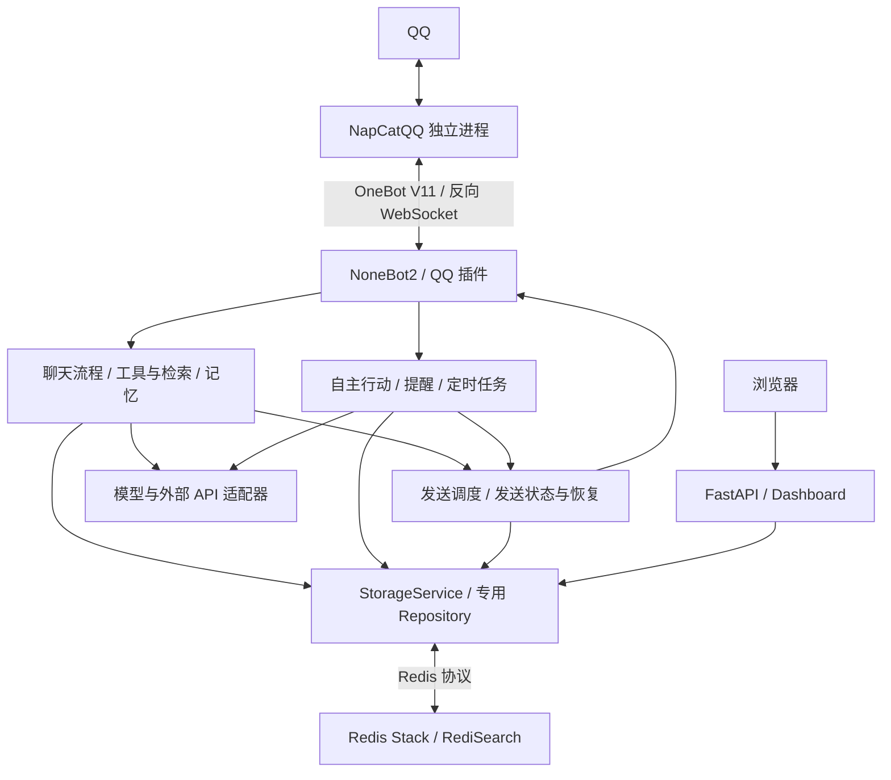

# 架构说明

[返回 README](../README.md) · [部署与状态检查](DEPLOYMENT.md) · [English](en/ARCHITECTURE.md)

Mako-Bot 是一个 Python 异步单体应用。NoneBot2 负责 QQ 事件和插件，同一个 FastAPI 服务提供健康检查与 Dashboard。NapCatQQ、Redis Stack 和模型/API 服务独立运行，分别通过 OneBot V11、Redis 协议或 HTTP 与应用连接。

## 模块职责

| 路径 | 职责 |
| --- | --- |
| `bot.py`、`src/app.py` | 源码与安装包入口，负责初始化 NoneBot、注册 OneBot V11 适配器、加载应用插件和退出时的清理 |
| `src/core/`、`src/models/`、`src/utils/` | 环境配置、人设提示词、日志与错误类型、数据模型、消息规范化及渲染辅助 |
| `src/plugins/` | 注册 QQ matcher、HTTP 路由和定时任务，组装运行时，将输入交给服务，再通过发送适配器返回结果 |
| `src/services/chat/` | 接纳与节奏控制、群聊窗口和候选回复、上下文组装、模型生成，以及聊天历史提交与恢复 |
| `src/services/tools/`、`src/services/governance/` | 意图路由、工具开关、群/私聊权限、黑名单、预算、工具并发与临时文件生命周期 |
| `src/services/retrieval/` | Ollama Web Search / Web Fetch 接入、查询规划、网页正文读取、来源排序、证据核验与检索指标 |
| `src/services/memory/` | 用户画像、笔记、关系与好感度、角色运行上下文、图片归档、每日知识整理及向量检索 |
| `src/services/autonomy/` | 自主行动规划、目标白名单、风险与冷却策略、owner 审批及行动执行 |
| `src/services/companion/` | 处理本人的考试计划、限定格式的命令、一次提醒和授权回顾，不使用模型推测授权或任务完成情况 |
| `src/services/delivery/` | 按目标排队、限频、去重并执行发送前检查，管理提醒和关系跟进的发送状态、补记与恢复 |
| `src/services/persistence/` | 提供 `StorageService` 门面、Redis/内存后端和各业务 Repository，用 Redis Lua 脚本完成需要原子确认的状态转换 |
| `src/services/integrations/`、`src/services/information/` | OpenAI 兼容接口、Gemini HTTP、图像、语言、天气、高德等适配器，以及新闻聚合 |
| `src/features/discoveries/` | 提供小鸟、历史传送和真实期刊查询，单独处理命令解析、候选轮换、公共 API 和来源标注 |
| `src/web/dashboard/` | Dashboard 数据汇总、展示模型和原生 HTML/CSS/ES modules，前端不使用打包器或第三方 UI 运行库 |
| `test/`、`deploy/`、`.github/workflows/` | 按业务域组织的测试、容器部署及 CI |

## 主要数据流与状态边界

1. QQ 插件先观察消息，维护群聊近期窗口，并按治理规则记录允许保存的消息。普通聊天会检查是否接纳消息、候选回复是否仍有效，以及能否获取会话锁。明确的工具命令、提醒和小功能各有处理入口。
2. 聊天流程读取历史快照、插件历史、画像和长期记忆，执行允许的工具，并补充图片或网页证据。涉及时效性事实时会核验来源，证据不足则说明无法确认。
3. `ChatEngine` 生成回复，模型调用凭据和费用由生成记录及费用消费逻辑管理。回复被取消或未发送时，已经发生的模型调用也有独立的记录状态。
4. 发送前保存历史发送计划，经公共发送调度器再次检查目标与候选状态。收到 OneBot 确认后，再提交会话历史、全局记录和后续补记。如果附件发送失败，不会重新发送主回复。
5. APScheduler 驱动提醒、每日记忆整理及分批恢复扫描。无法确认的模型调用或发送保留未决状态，恢复任务会补记已经确认的结果，未知结果则继续保留，不能直接当作失败重试。

Redis Stack 的 RediSearch 保存 HNSW 向量索引，嵌入模型由 `sentence-transformers` 按配置在需要时加载。部分 Repository 可以暂存于内存，但主聊天的生成凭据、历史发送计划和审批、恢复操作需要可确认的持久化状态，不能仅靠内存降级完整运行。 Dashboard 页面与静态资源由同一 FastAPI 服务提供，汇总 API 使用请求头中的 token 鉴权。

应用插件由 `src/core/bootstrap.py` 的固定清单选择，`chat` 和 `health` 始终启用。当前入口没有调用 `nonebot.load_from_toml()`，也没有加载 `nonebot_plugin_lagrange`。 `pyproject.toml` 中仍保留该插件及 `nonebot-plugin-localstore` 等声明依赖。插件与服务主要按职责分开，但部分服务仍使用 NoneBot 日志或 OneBot 类型，并有跨业务域依赖。

## 运行边界

考试陪伴使用独立的 `mako:companion:v1:*` 来源和 private 笔记，通过 `companion` 私聊发送类型接入现有的 DeliveryStore。提醒和回顾分别维护来源版本，原始事件意图和个人记忆控制共用待确认屏障。启动扫描和本人查询触发恢复时，只处理之前已接纳的原始意图。发送状态为 sent 后，`companion_complete` 补记会更新步骤和笔记。补记失败不会重新发送主消息。每次实际调用 SDK 前，都会再次核对来源、时间窗口、本人资格和记忆版本。

OneBot API 的确认用于记录发送状态，不能证明用户已经阅读消息，也不保证端到端恰好投递一次。生成、主消息、附件、历史提交和后台补记会分别处理。结果无法确认时会留下记录，避免直接当作失败重试。

人物档案和每日整理需要相应插件和模型配置。本地图片文件与 Redis 记录分别保存，需要分别维护。应用插件的选择与工具开关见[插件配置](CONFIGURATION.md#插件与工具)。
