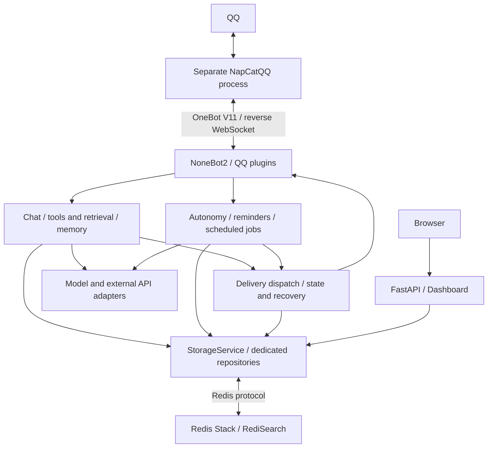

# Architecture

[README](../../README_EN.md) · [Deployment and health checks](DEPLOYMENT.md) · [中文](../ARCHITECTURE.md)

Mako-Bot is an asynchronous Python monolith. NoneBot2 handles QQ events and plugins, while the same FastAPI service provides health endpoints and the dashboard. NapCatQQ, Redis Stack and model/API services run separately, connecting through OneBot V11, Redis or HTTP.

## Module Responsibilities

| Path | Responsibility |
| --- | --- |
| `bot.py`, `src/app.py` | Source and installed-package entry points, NoneBot initialization, OneBot V11 adapter registration, application plugin loading and shutdown cleanup |
| `src/core/`, `src/models/`, `src/utils/` | Environment configuration, character prompts, logging, errors, data models, message normalization and rendering helpers |
| `src/plugins/` | QQ matchers, HTTP routes and scheduled jobs. Assemble runtimes, pass input to services and return results through delivery adapters |
| `src/services/chat/` | Admission and pacing, group windows and reply candidates, context assembly, model generation, history commit and recovery |
| `src/services/tools/`, `src/services/governance/` | Intent routing, tool switches, group/private permissions, blacklists, budgets, tool concurrency and temporary files |
| `src/services/retrieval/` | Ollama Web Search / Web Fetch, query planning, page reading, source ranking, evidence checks and retrieval metrics |
| `src/services/memory/` | Profiles, notes, relationships and affinity, character runtime context, image archives, daily consolidation and vector retrieval |
| `src/services/autonomy/` | Action planning, target allowlists, risk and cooldown policy, owner approval and execution |
| `src/services/companion/` | Self-owned exam plans, finite command syntax, one reminder and authorized reviews. Does not use a model to infer consent or completion |
| `src/services/delivery/` | Per-target queues, rate limits, deduplication, pre-send checks, reminder and relationship-follow-up delivery state, bookkeeping and recovery |
| `src/services/persistence/` | `StorageService` facade, Redis/in-memory backends and domain repositories. Redis Lua scripts provide atomic state confirmation |
| `src/services/integrations/`, `src/services/information/` | OpenAI-compatible, Gemini HTTP, image, language, weather and Amap adapters, plus news aggregation |
| `src/features/discoveries/` | Bird discovery, historical journeys and journal lookup, including parsing, rotation, public APIs and attribution |
| `src/web/dashboard/` | Dashboard queries, view models and native HTML/CSS/ES modules, without a frontend bundler or third-party UI runtime |
| `test/`, `deploy/`, `.github/workflows/` | Domain-organized tests, container deployment and CI |

## Data Flow and State Boundaries

1. QQ plugins observe messages, maintain recent group windows and record permitted input under governance rules. Ordinary chat checks admission, candidate validity and session locks. Explicit tools, reminders and discoveries have their own entry points.
2. Chat reads history snapshots, plugin history, profiles and long-term memory, executes allowed tools and adds images or web evidence. Time-sensitive facts require source checks. Insufficient evidence produces an explanation that the fact could not be confirmed.
3. `ChatEngine` generates a reply. Generation records and cost-consumption logic track model calls and charges. Calls already made retain their own state even if the reply is cancelled or never sent.
4. Before sending, the application saves a history delivery plan. The shared dispatcher rechecks the target and candidate. OneBot acknowledgement precedes history commits, global records and subsequent bookkeeping. An attachment failure does not resend the main reply.
5. APScheduler drives reminders, daily consolidation and paginated recovery scans. Unconfirmed model or send results remain pending. Recovery completes bookkeeping for confirmed results and retains unknown outcomes rather than treating them as failures to retry.

RediSearch stores HNSW vector indexes. `sentence-transformers` loads the configured embedding model on demand. Some repositories support temporary in-memory storage, but main-chat generation receipts, history delivery plans, approvals and recovery require confirmable persistent state. Memory-only fallback cannot run the whole application. Dashboard pages and assets use the same FastAPI service, with request-header token authentication for summary data.

Application plugins come from the fixed list in `src/core/bootstrap.py`. `chat` and `health` are always enabled. The entry point does not call `nonebot.load_from_toml()` or load `nonebot_plugin_lagrange`, although that plugin and `nonebot-plugin-localstore` remain declared dependencies. Plugins and services are mostly separated by responsibility, but some services still use NoneBot logging or OneBot types and have dependencies across domains.

## Runtime Boundaries

Exam companion uses separate `mako:companion:v1:*` sources and private notes, integrating with DeliveryStore through the `companion` private delivery type. Reminder and review sources have separate versions. Original event intents share a pending-result barrier with personal memory controls. Startup scans and self-service queries recover only previously accepted original intents. After delivery reaches sent, `companion_complete` bookkeeping updates steps and notes. Bookkeeping failure does not resend the main message. Each actual SDK call rechecks the source, time window, user eligibility and memory version.

OneBot acknowledgement records delivery state. It does not prove the user read a message or guarantee end-to-end exactly-once delivery. Generation, main messages, attachments, history commits and background bookkeeping are tracked separately. Unknown outcomes remain recorded to avoid blind retries.

Profiles and daily consolidation require their plugins and model settings. Local image files and Redis records require separate maintenance. See [plugin configuration](CONFIGURATION.md#plugins-and-tools).
